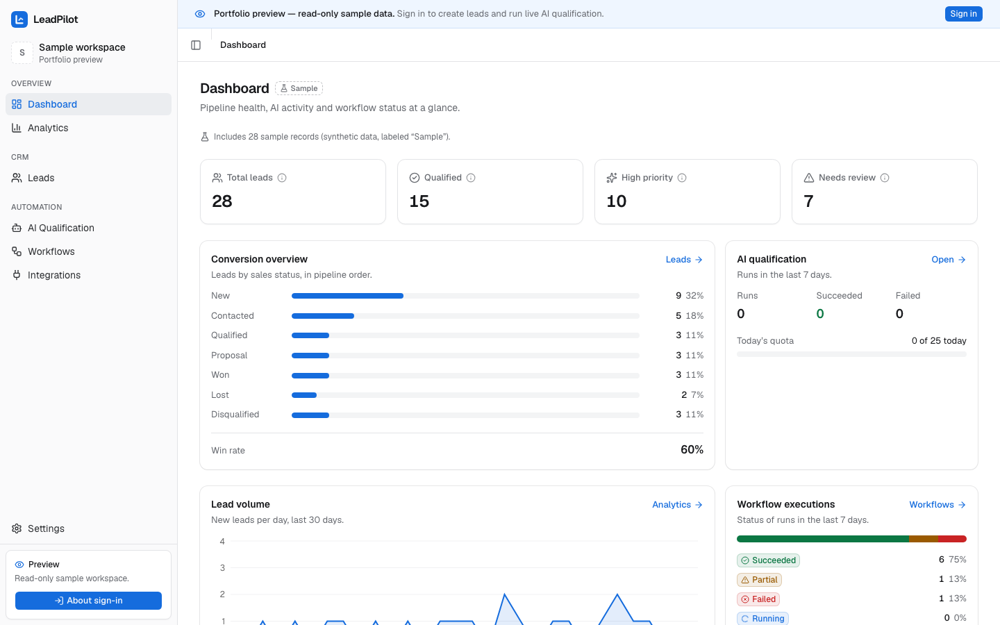
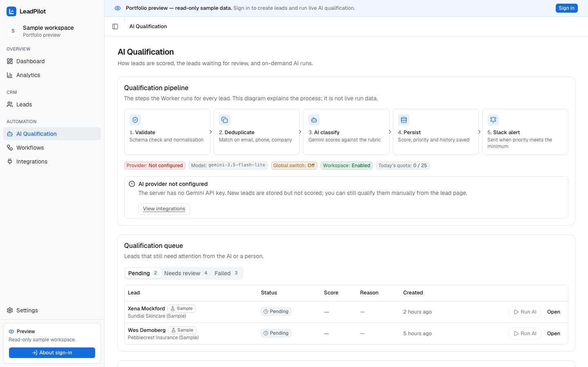
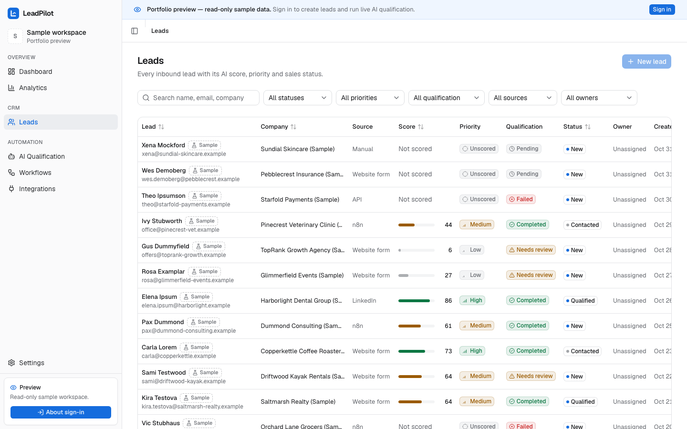
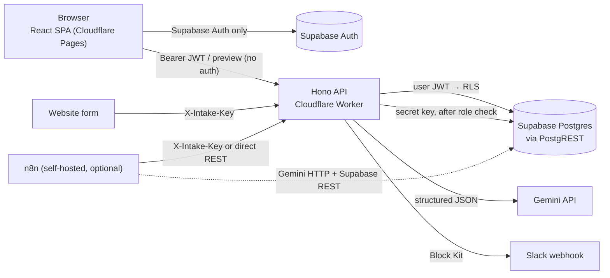

# LeadPilot AI

LeadPilot AI is a small, multi-tenant CRM that qualifies inbound leads with Google Gemini. Leads arrive from the app, a website form or an n8n workflow; the backend deduplicates them, asks Gemini for a structured, rubric-based score, reconciles that score server-side, routes low-confidence results to human review, and alerts Slack about high-priority leads. Every run is recorded step by step so failures are visible and retryable. It is a portfolio project built to run entirely on free tiers (Cloudflare Workers + Pages, Supabase, Gemini free tier).

> **Status (2026-10-31):** code complete and tested locally. **Not yet deployed:** there is no public demo URL (_pending deployment_). No real Gemini, Slack or Supabase-cloud call has been made yet; all AI and Slack tests use stand-in responses. The n8n workflow has been validated statically and its Code-node logic unit-tested, but it has **not** been executed inside n8n. See [Limitations](#limitations--honest-status).

**Live demo:** _pending deployment_ (`https://<your-project>.pages.dev/preview/dashboard` once deployed)

## Features

- **Auth & workspaces:** Supabase Auth (email/password, password reset). Each new user gets a workspace with the `owner` role; roles are `viewer` < `member` < `admin` < `owner`.
- **Lead CRM:** list with search, filters, sorting and pagination; create/edit/delete; duplicate detection (normalized email, phone, company); notes; activity timeline; owner assignment.
- **AI qualification:** Gemini structured output (JSON schema) against an editable weighted rubric; score reconciled on the server; priority from configurable thresholds; low confidence or spam goes to `needs_review`; manual override with history.
- **Webhook intake:** `POST /api/v1/intake/:workspaceId` with a hashed intake key, idempotency key, honeypot and per-IP rate limit.
- **Slack alerts:** Block Kit message for leads at or above a configurable priority; webhook URL stored encrypted; test button.
- **Workflow history:** every intake/qualification/Slack run stored with per-step timing and status; failed or partial runs can be retried.
- **Dashboard & analytics:** funnel, win rate, sources, score distribution, AI activity and quota, computed in SQL.
- **Read-only portfolio preview:** `/preview/*` shows the whole app on synthetic sample data without signing in.
- **Optional n8n workflow:** the same pipeline as an importable n8n v2 workflow writing `engine = 'n8n'` executions.

## Screenshots

Captured from the running app's read-only preview (`/preview/*`) with **synthetic sample data** (no real people or companies).

| Dashboard & analytics | AI qualification | Leads & workflow executions |
|---|---|---|
|  |  |  |

## Tech stack

| Layer | Choice |
|---|---|
| Frontend | Vite 8, React 19, TypeScript 7 (strict), Tailwind 4, shadcn/ui (Base UI), TanStack Query 5, React Router 7, Recharts 3 → Cloudflare Pages |
| API | Hono on a Cloudflare Worker; `jose` JWT verification (JWKS, HS256 fallback) |
| Data & auth | Supabase Postgres (RLS on every table, column grants, SQL RPCs) + Supabase Auth, accessed through PostgREST |
| AI | Google Gemini `gemini-3.5-flash-lite` (configurable) via REST `generateContent` with `responseJsonSchema`; Zod validation |
| Automation | Slack incoming webhooks; optional self-hosted n8n 2.x |
| Shared | `packages/shared`: Zod schemas, enums, scoring, prompt/contract, API types |
| Tests | Vitest (unit, real-Postgres DB, API→PostgREST→Postgres integration), `node --test` (n8n), Playwright (E2E) |

## Architecture



Details, sequence diagrams, the data model and the authorization matrix: [docs/ARCHITECTURE.md](docs/ARCHITECTURE.md). API reference: [docs/API.md](docs/API.md).

## Quick start (local, no cloud accounts)

Requires Node ≥ 22.12 and a local PostgreSQL with `psql` on `PATH`.

```bash
npm install
./scripts/get-postgrest.sh        # downloads the PostgREST binary into .tools/
npm run dev:local                 # local Postgres (seeded) → PostgREST → wrangler dev → Vite
```

Open <http://127.0.0.1:5173/preview/dashboard>. In this mode only the read-only preview works (sign-in needs a Supabase project) and AI is disabled (`AI_ENABLED=false`, no Gemini key).

**Full mode** (sign-up, CRUD, AI, Slack): create the free accounts and fill `apps/api/.dev.vars` and `apps/web/.env.local` as described in [docs/DEPLOYMENT.md](docs/DEPLOYMENT.md#1-supabase), then run `npm run dev:api` and `npm run dev:web`.

## Testing

| Command | What it runs | Result (run 2026-10-31) |
|---|---|---|
| `npm run check` | typecheck + lint (all packages) + unit tests | passes: shared 46, API 66, web 40 tests |
| `npm run test:db` | RLS / grants / RPC / integrity tests against a real local Postgres | 120 passed |
| `npm run test:integration` | API → PostgREST → Postgres with RLS (AI and Slack stubbed) | 41 passed |
| `npm run test:n8n` | workflow JSON validation + Code-node tests (parity with `packages/shared`) | validation passes, 52 passed |
| `npm run test:e2e` | Playwright against the running app (`E2E_BASE_URL`, default local) | 12 passed, 1 skipped (authenticated lifecycle needs a Supabase project) |

`test:db` and `test:integration` recreate a local database from the migrations and seed; `test:integration` needs `./scripts/get-postgrest.sh` first. Counts change as tests are added; rerun the commands for current numbers.

## Security & cost protection

- **Row Level Security** on every table; policies call `is_workspace_member` / `has_workspace_role`. User requests reach PostgREST with the user's own JWT.
- **Column-level grants:** users can only insert/update CRM fields; AI fields, scores and statuses are writable only by the server.
- **Server-side secrets:** the browser holds only the Supabase publishable key and the API URL. The secret key, Gemini key and encryption key exist only as Worker secrets.
- **Slack webhook URL** encrypted with AES-256-GCM (`ENCRYPTION_KEY`); only a masked hint is readable.
- **Intake keys** shown once, stored as SHA-256 hashes, compared in constant time; same `401` for unknown workspace and wrong key.
- **AI quota reservation:** `reserve_ai_call` (advisory-locked) enforces per-workspace and global daily limits *before* each Gemini call.
- **Kill switch:** `AI_ENABLED=false` stops all Gemini calls; workspaces can also disable AI.
- **Rate limits:** API 120/min, AI 6/min/user, intake 10/min/IP (Workers Rate Limiting binding, in-memory fallback).
- **Privacy-minimized prompts:** Gemini receives the email **domain**, company, title, website, source and message, never name, full email or phone.
- ⚠️ **Gemini free tier:** Google may use free-tier prompts to improve its products, and the free tier may not be offered to users in the EEA, Switzerland or UK. Use synthetic data only.

## n8n (optional)

`n8n/leadpilot-lead-qualification.workflow.json` implements the same validate → deduplicate → Gemini → reconcile → persist → Slack → record pipeline in a self-hosted n8n 2.x instance. The app never depends on it. Setup, credentials and troubleshooting: [docs/N8N.md](docs/N8N.md). **Verified only statically** (structure validation, secret scan, Code-node unit tests); not yet executed in n8n.

## Project structure

```
apps/web          React SPA (Cloudflare Pages)
apps/api          Hono API Worker: routes, services (gemini, qualification, slack, crypto), tests
packages/shared   Zod schemas, scoring, AI prompt + response schema, sample data, API types
supabase/         migrations (schema, security/RLS, analytics RPCs), seed.sql, local test shim
n8n/              workflow JSON, Code-node sources, build/validate scripts, tests
e2e/              Playwright tests
scripts/          local stack, local DB reset, PostgREST download, seed generation
docs/             PLAN, ARCHITECTURE, API, FRONTEND, N8N, DEPLOYMENT, DEMO-CHECKLIST
```

## Limitations & honest status

- No public deployment yet; the demo URL above is a placeholder.
- No real Gemini call has been made. Prompt quality, latency and score calibration on real model output are unverified.
- No real Slack message has been sent; Slack tests use a stubbed `fetch`.
- The schema has only been applied to local PostgreSQL (kept PG14-compatible), not yet to a Supabase project.
- n8n workflow executed in a local n8n 2.45.7 (Docker) with AI disabled: validation, dedupe, persistence, honeypot, auth and execution write-back verified. The Gemini and Slack branches have not run inside n8n (no keys).
- No usage metrics, customers or business results exist; all data shown is synthetic.
- Single-region free tiers: Supabase pauses projects after 7 days of inactivity; Workers free plan has a 10 ms CPU budget per request.
- No invitations/member management UI beyond listing members; one workspace is created per sign-up.

## License

[MIT](LICENSE)
