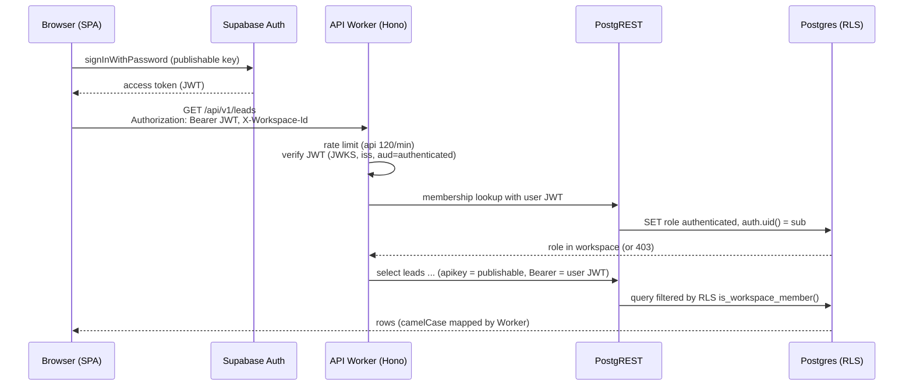
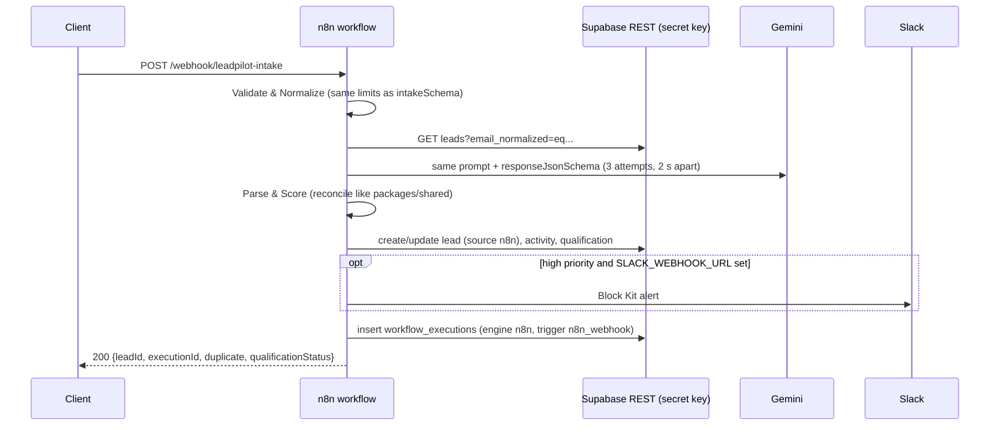
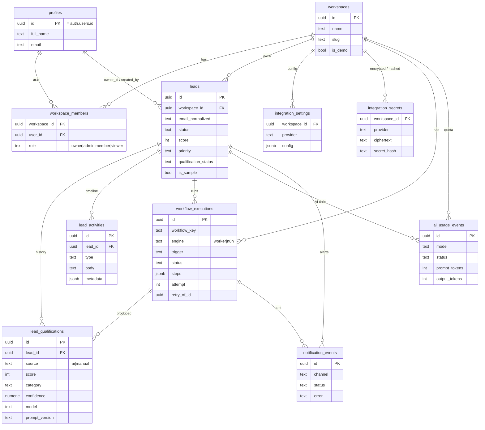

# LeadPilot AI — Architecture

This document describes what is implemented in the repository. Anything not yet verified against real cloud services is marked as such.

## 1. Components

| Component | Where | Responsibility |
|---|---|---|
| Web SPA | `apps/web` → Cloudflare Pages | UI. Uses `supabase-js` **only for Auth** (sign up, sign in, reset). All data goes through the API with `Authorization: Bearer <Supabase access token>`. `/preview/*` uses `/api/v1/demo/*` without auth. |
| API Worker | `apps/api` → Cloudflare Worker (Hono) | JWT verification, role checks, CRUD via PostgREST with the user's JWT (RLS), system writes with the secret key, AI pipeline, Slack, intake webhook, rate limiting. |
| Database | `supabase/migrations` → Supabase Postgres | Tables, RLS policies, column grants, triggers, quota RPC (`reserve_ai_call`), analytics RPCs (`dashboard_summary`, `lead_analytics`, `workflow_overview`). |
| Auth | Supabase Auth | Users; trigger `handle_new_user` creates profile + workspace + `owner` membership. |
| Shared contracts | `packages/shared` | Zod schemas, enums, normalization, scoring/reconciliation, prompt builders, response JSON schema, sample data. |
| Gemini | Google AI REST API | `generateContent` with structured JSON output. |
| Slack | Incoming webhook | High-priority alerts and test messages. |
| n8n (optional) | `n8n/` | Self-hosted alternative pipeline writing `engine = 'n8n'` executions. Not required by the app. |

Local development replaces Supabase with local PostgreSQL + the PostgREST binary + a locally signed HS256 JWT (`scripts/local-stack.mjs`). Only the read-only preview works in that mode.

## 2. Request flows

### 2.1 Authenticated request (RLS)



Mutations follow the same path; RLS (`has_workspace_role(..., 'member'|'admin')`) and column grants are the final guard even if a Worker check were missed.

### 2.2 Webhook intake → AI → Slack (Worker pipeline)

```mermaid
sequenceDiagram
  participant F as Website form / client
  participant W as API Worker
  participant P as Postgres (secret key)
  participant G as Gemini
  participant S as Slack
  F->>W: POST /api/v1/intake/:workspaceId<br/>X-Intake-Key, Idempotency-Key
  W->>W: rate limit 10/min/IP · honeypot → 202 · Zod validation → 422
  W->>P: verify SHA-256(key) (constant-time) → 401 if wrong
  W->>P: idempotency replay? dedupe by normalized email
  W->>P: insert/update lead, activity; start workflow_executions row
  W->>P: rpc reserve_ai_call (advisory lock, daily limits)
  alt AI disabled / quota exceeded
    W->>P: lead qualification_status skipped/failed + reason
  else reserved
    W->>G: generateContent (responseJsonSchema, ≤3 attempts)
    G-->>W: JSON
    W->>W: Zod parse → reconcileScore → priority → completed/needs_review
    W->>P: lead_qualifications row, lead AI fields, ai_usage_events
  end
  opt priority ≥ workspace minPriority and Slack enabled
    W->>P: read encrypted webhook, AES-GCM decrypt
    W->>S: Block Kit message
    W->>P: notification_events row
  end
  W->>P: finish execution (succeeded / partial / failed, steps[])
  W-->>F: 201/200 IntakeResult
```

A Slack failure never fails the lead: the execution becomes `partial`. Manual runs (`POST /leads/:id/qualify`) and retries (`POST /workflows/executions/:id/retry`) reuse the same qualification service.

### 2.3 n8n path (optional; verified locally with AI disabled)



n8n bypasses the Worker (and therefore its quota RPC and rate limits); it uses its own retries and the operator's Gemini quota. See [N8N.md](N8N.md).

## 3. Data model



Column lists are abbreviated; see `supabase/migrations/20261031000100_core_schema.sql` for the full definitions, constraints and triggers (`enforce_lead_owner_membership`, `prevent_workspace_change`, `enforce_lead_workspace`, `set_updated_at`).

## 4. Authorization model

Roles rank `viewer` < `member` < `admin` < `owner`. The Worker checks the role first; RLS and column grants enforce it again in the database.

| Action | viewer | member | admin | owner | Enforced by |
|---|:-:|:-:|:-:|:-:|---|
| Read leads, activities, qualifications, executions, analytics, integration status | ✓ | ✓ | ✓ | ✓ | RLS `is_workspace_member` |
| Create / edit leads, add notes | — | ✓ | ✓ | ✓ | Worker + RLS `has_workspace_role('member')` + column grants |
| Run AI, override qualification, retry execution | — | ✓ | ✓ | ✓ | Worker role check, then secret-key write |
| Delete leads | — | — | ✓ | ✓ | Worker + RLS `has_workspace_role('admin')` |
| Workspace name, AI settings, Slack, intake key, sample data | — | — | ✓ | ✓ | Worker role check (+ RLS for workspace update) |
| Write AI fields / scores / executions / usage / secrets directly | — | — | — | — | No grant to `authenticated`; server only |
| Anonymous preview (`/api/v1/demo/*`) | read-only on the `is_demo` workspace; mutations → `403 read_only` | | | | `middleware/demo.ts` |
| Intake webhook | holder of the workspace intake key | | | | SHA-256 hash comparison |

## 5. AI pipeline

- **Model / request:** `gemini-3.5-flash-lite` by default (`GEMINI_MODEL`). `POST v1beta/models/{model}:generateContent`, header `x-goog-api-key`, `responseMimeType: application/json` + `responseJsonSchema`, minimal thinking, `maxOutputTokens` 1024, timeout `GEMINI_TIMEOUT_MS` (20 s).
- **Prompt** (`packages/shared/src/ai.ts`, version `lp-qualify-v1`): system instruction with the workspace business context, allowed categories, weighted rubric (default: intent 25, fit 25, budget/timeline 20, authority 15, completeness 15) and thresholds. The user prompt contains only email domain, company, title, website, source and message.
- **Schema & validation:** response schema built from the workspace's categories and criteria; output parsed with Zod (`aiQualificationOutputSchema`), JSON code fences stripped. Invalid output → `ai_invalid_response`, recorded as a failed step.
- **Reconciliation** (`reconcileScore`): criterion scores clamped to their maxima, unknown/duplicate criteria ignored; if the stated total differs from the criterion sum by more than 5, the sum wins; priority always derived from the final score (default high ≥ 70, medium ≥ 40); `spam` forces low. Every correction is stored as an adjustment note.
- **Review routing:** confidence below `reviewConfidence` (default 0.6) or category `spam` → `needs_review`; otherwise `completed`. Users can override with a manual history row.
- **Retries:** up to 3 attempts for timeouts, network errors, 429 and 5xx; backoff 0.8 s then 2 s, honouring the server's `retryDelay` up to 5 s. Daily-quota 429s, auth errors, 4xx, blocked or invalid responses are not retried. Failed executions can be retried manually (up to attempt 20).
- **Quota:** before any call, `reserve_ai_call` takes an advisory lock, counts today's (UTC) non-rejected usage and inserts a `pending` reservation if under `AI_DAILY_LIMIT_PER_WORKSPACE` (25) and `AI_DAILY_LIMIT_GLOBAL` (150); otherwise `429 ai_quota_exceeded`. The reservation is finalized with status and token counts.

**Verification status:** all of the above is unit- and integration-tested with stubbed Gemini responses. No real Gemini response has been processed yet.

## 6. Failure handling

| Failure | Behaviour |
|---|---|
| Gemini unavailable / invalid after retries | Lead kept; `qualification_status = failed` with reason; execution `failed` (manual) or `partial` (intake); retry available. |
| AI disabled (env or workspace) / quota exhausted | Step `skipped`; lead `skipped`/`failed` with reason; `503 ai_disabled` or `429 ai_quota_exceeded` for manual runs. |
| Slack error | `notification_events` row `failed`; execution `partial`; lead unaffected. |
| Duplicate intake | Existing lead updated (`200`); same `Idempotency-Key` replays the original result. |
| Bad input | `422 validation_error` with field paths; honeypot → `202` with nothing stored. |
| Unexpected error | `500 internal_error` with `requestId`; every response carries `X-Request-Id` and structured logs. |

## 7. Free-tier constraints

| Service | Limit | Design response |
|---|---|---|
| Cloudflare Workers (free) | 10 ms CPU per request (network wait excluded), 50 subrequests per request, 100,000 requests/day | Aggregates in SQL RPCs; lean handlers; at most a few PostgREST + 3 Gemini + 1 Slack subrequests per pipeline. |
| Supabase (free) | 500 MB database; projects pause after 7 days of inactivity; built-in SMTP about 2 emails/hour | Small rows; docs explain unpausing; disable email confirmation or use custom SMTP for demos. |
| Gemini API (free tier) | Per-model RPM / RPD limits shown in AI Studio (*Rate limit*); prompts may be used by Google to improve products; free tier not offered to users in the EEA, Switzerland or UK | Daily quota RPC below the AI Studio limits; privacy-minimized prompts; synthetic data only; `AI_ENABLED` kill switch. |
| Workers Rate Limiting binding | Free-plan availability not verified | Optional `ratelimits` block; in-memory per-isolate fallback. |
